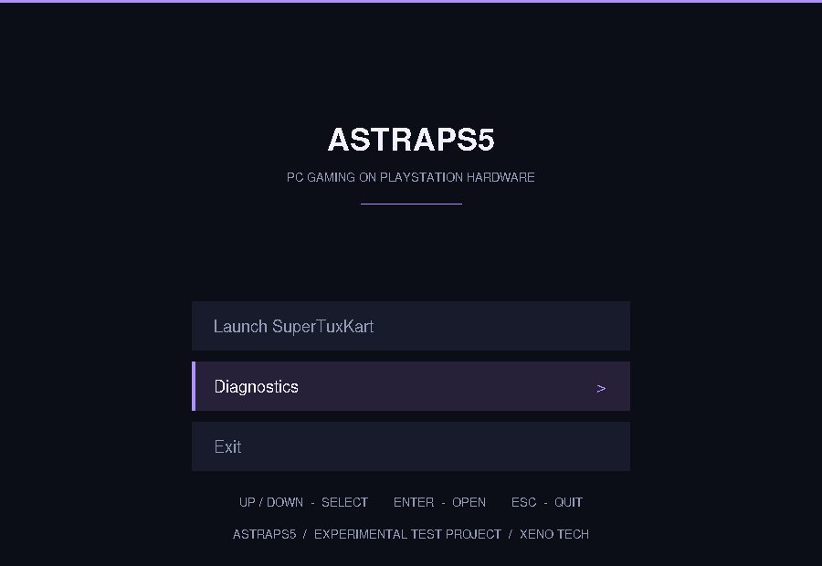

# AstraPS5

**PC gaming. Beyond the platform.**

> [!IMPORTANT]
> **EXPERIMENTAL TEST PROJECT.** AstraPS5 is early research software. It does **not** boot from the PS5 home screen, run PC games, support multiplayer, or offer a downloadable PS5 app. The graphical menu included here is a desktop-Linux prototype, **not a PS5 application**.

AstraPS5 is an independent open-source **Xeno Tech** project researching a direct-boot gaming experience for PC games on compatible PlayStation 5 hardware. The long-term idea is to open AstraPS5 from a PS5 app/tile on **supported homebrew-capable consoles**, then boot into a purpose-built gaming environment without manually using a Linux desktop.

For now, the repository is a small, **connected C++17 project** with real system diagnostics and a deliberately bare-minimum graphical menu.

## What is included

| Component | Status |
| --- | --- |
| `astra doctor` / `astra doctor --json` | Implemented: read-only host diagnostics |
| `astra menu` | Implemented: minimal native graphical menu prototype |
| `astra boot verify <manifest>` | Implemented: SHA-256 image integrity preflight; **does not boot a console** |
| Diagnostics page inside menu | Implemented: displays the same diagnostics as the CLI |
| PS5 home-screen app / bootloader | Not implemented |
| Native Linux or Wine/Proton game launching | Not implemented |
| PS5 hardware validation, game compatibility or online multiplayer | Not verified / not implemented |

### Minimal UI

The menu contains only **Diagnostics** and **Exit**. It has no game cards, mock library, fake launch buttons, or pretend console connections. The Diagnostics button uses the **existing Astra Core** code, rather than displaying fabricated information.



The X11 UI runs on desktop Linux or an XWayland session. It is an early testing surface for a later controller-first Astra Shell; **controller support is not implemented yet**.

## Build and run on Linux

Requirements: CMake 3.16+, C++17 compiler, OpenSSL development headers for SHA-256, and X11 development headers for the GUI.

On Debian/Ubuntu:

```bash
sudo apt install build-essential cmake libx11-dev libssl-dev
```

On Arch/CachyOS:

```bash
sudo pacman -S --needed base-devel cmake libx11 openssl
```

Then from the AstraPS5 repository root:

```bash
cmake -S . -B build -DCMAKE_BUILD_TYPE=Release
cmake --build build -j
ctest --test-dir build --output-on-failure

./build/astra menu
```

Inside the menu, use **Up / Down**, **Enter**, **Escape**, or the mouse. The system information is collected on the machine that runs the program; running it on a PC is **not** proof of PS5 compatibility.

The command-line tools remain available (see [boot manifest instructions](docs/boot-manifest.md) for a real image):

```bash
./build/astra doctor
./build/astra doctor --json
./build/astra version
./build/astra boot verify examples/astraps5.boot.example  # fails until a real image/hash is provided
./build/astra help
```

Without the X11 development headers, the CLI still builds; `astra menu` prints a dependency message instead of opening a window. X11/XWayland is needed at runtime for this prototype. Linux and graphics requirements for a future PS5 system are separate.

## Source layout

```text
AstraPS5/
├── .github/workflows/ci.yml   Build and test on Linux
├── CMakeLists.txt              Single CMake project
├── include/astraps5/          C++ public headers
├── src/
│   ├── main.cpp               Astra CLI entry point
│   ├── boot.cpp               Read-only image integrity preflight
│   ├── diagnostics.cpp        Actual Linux diagnostics
│   ├── menu_state.cpp         UI navigation logic
│   ├── menu_x11.cpp           Minimal native Linux window
│   └── menu_stub.cpp          Fallback when X11 is absent
├── tests/                      Diagnostics and menu unit tests
├── examples/                   Boot manifest template (not bootable)
└── docs/                       Research and plans
```

## Long-term direction

```text
PS5 home screen on supported homebrew-capable firmware
      ↓
Astra Entry / Astra Boot              (not implemented)
      ↓
Astra gaming Linux image              (not implemented)
      ↓
Astra Shell / PC game runtime         (minimal shell prototype only)
      ↓
PC game servers where officially supported
```

The entry app, boot handoff, bootable image format, GPU drivers, game runtime, and multiplayer have substantial unanswered engineering constraints. There is no guaranteed method for installing AstraPS5 as a normal app on a stock retail PS5.

For the actual research plans, read [Architecture](docs/architecture.md), [Boot concept](docs/app-first-boot.md), [Boot manifest v1](docs/boot-manifest.md), [Roadmap](docs/roadmap.md), and [First hardware test](docs/first-ps5-test.md).

## License and independence

AstraPS5 original source code is licensed under **[Apache-2.0](LICENSE)**. See [NOTICE](NOTICE). It does not ship PlayStation firmware, console security keys, games, or proprietary Sony software. Third-party software retains its own license.

AstraPS5 is not affiliated with or endorsed by Sony Interactive Entertainment, Valve, or Microsoft. PlayStation and PS5 are trademarks of Sony Interactive Entertainment.

**Xeno Tech · AstraPS5 v0.2.1-dev · Experimental Test Project**
