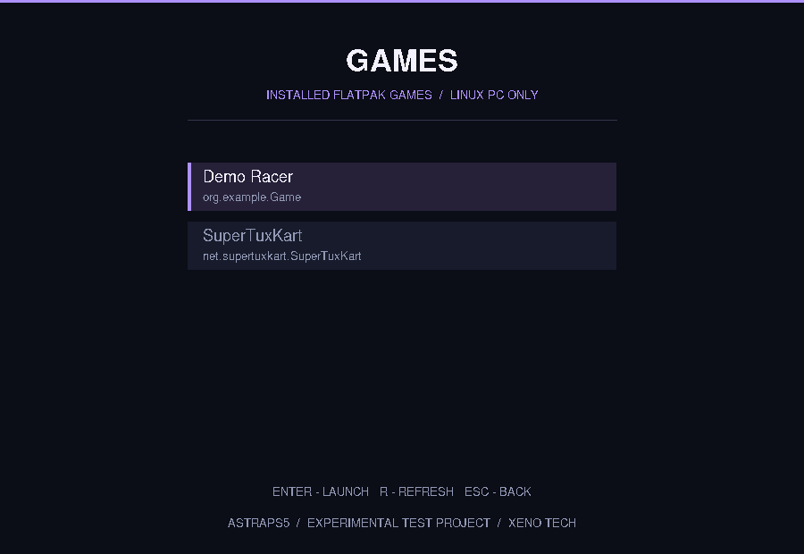

# AstraPS5

**PC gaming. Beyond the platform.**

> [!IMPORTANT]
> **EXPERIMENTAL TEST PROJECT.** AstraPS5 is early research software. It does **not** boot from the PS5 home screen, support multiplayer, or offer a downloadable PS5 app. Native and Flatpak Linux game launching is available **on a regular Linux development PC only**, not validated on PS5 hardware. The graphical menu included here is a desktop-Linux prototype, **not a PS5 application**.

AstraPS5 is an independent open-source **Xeno Tech** project researching a direct-boot gaming experience for PC games on compatible PlayStation 5 hardware. The long-term idea is to open AstraPS5 from a PS5 app/tile on **supported homebrew-capable consoles**, then boot into a purpose-built gaming environment without manually using a Linux desktop.

For now, the repository is a small, **connected C++17 project** with real system diagnostics, a deliberately bare-minimum graphical menu, a discoverable Flatpak game library, and a Linux game launcher supporting native executables and Flatpak games.

## What is included

| Component | Status |
| --- | --- |
| `astra doctor` / `astra doctor --json` | Implemented: read-only host diagnostics |
| `astra menu` | Implemented: minimal native graphical menu, with an installed-Flatpak game list and launch actions |
| `astra boot verify <manifest>` | Implemented: SHA-256 image integrity preflight; **does not boot a console** |
| `astra game check/run <profile>` | Implemented: check/launch Linux-native and Flatpak profiles on a development PC, capturing per-session logs |
| `astra games list [--json]` | Implemented: discover installed Flatpak games using exported desktop metadata |
| `astra games run <app_id>` | Implemented: launch a detected Flatpak game by ID |
| Diagnostics page inside menu | Implemented: displays the same diagnostics as the CLI |
| PS5 home-screen app / bootloader | Not implemented |
| Linux PC game launching | Implemented for native executables and installed Flatpak apps; PC Linux only |
| Windows games through Wine/Proton | Not implemented |
| PS5 hardware validation or online multiplayer | Not verified / not implemented |

### Minimal UI

The home menu stays minimal: **Games**, **Diagnostics**, and **Exit**. **Games** opens a plain list of actual installed Flatpak games categorized as `Game` (including SuperTuxKart if installed). Select a title to launch it without freezing the menu; logs and exit codes are captured. Press **R** to refresh. There are no fake game cards or simulated PS5 connections. Diagnostics uses **existing Astra Core** code.



*Screenshot from a desktop-Linux UI test with two mock Flatpak applications; not from a PS5.*

The X11 UI runs on desktop Linux or an XWayland session. It is an early testing surface for a later controller-first Astra Shell; **controller support is not implemented yet**. The Games page requires exported `.desktop` metadata with a `Game` category; see [game library documentation](docs/game-library.md).

## Build and run on Linux

Requirements: CMake 3.16+, C++17 compiler, OpenSSL development headers for SHA-256, and X11 development headers for the GUI.

On Debian/Ubuntu:

```bash
sudo apt install build-essential cmake libx11-dev libssl-dev
```

On Arch/CachyOS:

```bash
sudo pacman -S --needed base-devel cmake libx11 openssl
```

Then from the AstraPS5 repository root:

```bash
cmake -S . -B build -DCMAKE_BUILD_TYPE=Release
cmake --build build -j
ctest --test-dir build --output-on-failure

./build/astra menu
```

Inside the menu, use **Up / Down**, **Enter**, **Escape**, or the mouse. The system information is collected on the machine that runs the program; running it on a PC is **not** proof of PS5 compatibility.

The command-line tools remain available (see [boot manifest instructions](docs/boot-manifest.md) for a real image):

```bash
./build/astra doctor
./build/astra games list
./build/astra games list --json
./build/astra games run net.supertuxkart.SuperTuxKart  # when installed
./build/astra doctor --json
./build/astra version
./build/astra game check examples/supertuxkart.game.example  # for native Linux package
./build/astra game check examples/supertuxkart-flatpak.game.example  # for the Flatpak
./build/astra game run examples/supertuxkart-flatpak.game.example
./build/astra boot verify examples/astraps5.boot.example  # fails until a real image/hash is provided
./build/astra help
```

Without the X11 development headers, the CLI still builds; `astra menu` prints a dependency message instead of opening a window. X11/XWayland is needed at runtime for this prototype. Linux and graphics requirements for a future PS5 system are separate.

## Source layout

```text
AstraPS5/
├── .github/workflows/ci.yml   Build and test on Linux
├── CMakeLists.txt              Single CMake project
├── include/astraps5/          C++ public headers
├── src/
│   ├── game.cpp               Native/Flatpak profiles, logs and process launch
│   ├── library.cpp            Read-only installed Flatpak game discovery
│   ├── main.cpp               Astra CLI entry point
│   ├── boot.cpp               Read-only image integrity preflight
│   ├── diagnostics.cpp        Actual Linux diagnostics
│   ├── menu_state.cpp         UI navigation logic
│   ├── menu_x11.cpp           Minimal native Linux window
│   └── menu_stub.cpp          Fallback when X11 is absent
├── tests/                      Diagnostics, runtime and menu unit tests
├── examples/                   Boot manifest + native/Flatpak game examples
└── docs/                       Research and plans
```

## Long-term direction

```text
PS5 home screen on supported homebrew-capable firmware
      ↓
Astra Entry / Astra Boot              (not implemented)
      ↓
Astra gaming Linux image              (not implemented)
      ↓
Astra Shell / PC game runtime         (minimal shell prototype only)
      ↓
PC game servers where officially supported
```

The entry app, boot handoff, bootable image format, GPU drivers, game runtime, and multiplayer have substantial unanswered engineering constraints. There is no guaranteed method for installing AstraPS5 as a normal app on a stock retail PS5.

For native and Flatpak game testing, read [Linux game launcher](docs/native-game-launcher.md), [dynamic game library](docs/game-library.md) and the [test compatibility record](docs/compatibility.md).

For the actual research plans, read [Architecture](docs/architecture.md), [Boot concept](docs/app-first-boot.md), [Boot manifest v1](docs/boot-manifest.md), [Roadmap](docs/roadmap.md), and [First hardware test](docs/first-ps5-test.md).

## License and independence

AstraPS5 original source code is licensed under **[Apache-2.0](LICENSE)**. See [NOTICE](NOTICE). It does not ship PlayStation firmware, console security keys, games, or proprietary Sony software. Third-party software retains its own license.

AstraPS5 is not affiliated with or endorsed by Sony Interactive Entertainment, Valve, or Microsoft. PlayStation and PS5 are trademarks of Sony Interactive Entertainment.

**Xeno Tech · AstraPS5 v0.2.4-dev · Experimental Test Project**
